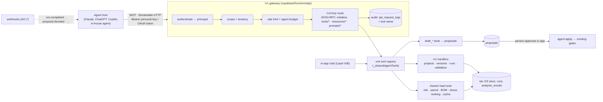

# Agent interoperability plan: SuReSuite as a tool surface for external AI agents

> **Status: AUTHORED, PROPOSED (2026-11-06).** Nothing in this plan is built yet except what
> §2 lists as existing. Five owner decisions (§8) are open. Each has a stated default, so
> work can start without waiting for them.
> **Closes:** blueprint gap **G22** (added with this plan).
> **Proposed resolution of:** `ai-agents.md` §10 **Q17** (MCP exposure), still pending
> owner approval (§8, decision AG-D1).
> **Companion to:** `next-gen-platform-design.md` §12 (AI-native capabilities) and §13 (the
> cross-cutting API workstream), `public-api-and-access-control.md` (the `/v1` gateway
> this plan builds on), `ai-agents.md` (the in-app agents whose tools this plan shares).

---

## 0. How to use this plan

- **Read §3 (the laws) before writing any code for this plan.** Every work package is
  judged against them. A package that needs to break a law changes this document first,
  in the same commit, with the reason.
- **§4 is the design. §9 is the work.** Each work package (WP AG.n) names its
  deliverables, the gates it adds, its exit criterion and its size. A package is done
  when its exit criterion is met *in production*. Merged to `main` is not enough:
  `contract:check` R17 and §4 D123/D168 of `docs/PLAN.md` show how often those two
  differ.
- **Data-layer evidence is not restated here.** Anything about ingestion, the ETL, the
  policy grid, the engine mapping or migrations cites `docs/PLAN.md` §4 by D-number
  (`single-source`, enforced by `npm run check:docs`).
- **Commit convention:** `Agent interop / WP AG.n / <blueprint ref>: <title>`, e.g.
  `Agent interop / WP AG.3 / G22 §12: read-only MCP endpoint on the /v1 gateway`.
- **Every package ends with a §11 change-log entry:** what the previous package promised
  against what this one found. If a finding changes a later package, edit that package
  here in the same commit.

---

## 1. What we are building, and why

### 1.1 The problem (G22)

People increasingly do analytical work *through* an AI agent: Claude (Desktop, Code or
claude.ai), ChatGPT, Microsoft Copilot, or an agent their own company builds on an agent
framework. These hosts connect to outside systems through a standard tool protocol, the
**Model Context Protocol (MCP)**, and more and more of them only through it.

SuReSuite already has everything such an agent needs to give *grounded* supply-chain
decision support:

- versioned, hashed data;
- a reproducible simulation engine;
- a run cache;
- a validation pipeline;
- stored stress-test rankings;
- a gated proposal fabric.

All of it is reachable today only through two doors:

1. **the in-app chat**, which only works inside the app, with the models we host;
2. **the `/v1` REST API**, which a developer can script against, but which an agent host
   cannot *discover* or call as tools.

So an external agent asked "which single supplier outage would cost us the most sales,
and what would dual-sourcing it buy us?" has no way to reach the answer the platform
already holds. It either declines, or it does the dangerous thing and estimates.

**G22 — No standard agent-interoperability surface.** External AI agents cannot
discover, authenticate to, or call the platform's capabilities as tools. The
consequence: the platform's main advantage over a bare language model (every number
has a source, a version and a reproducible run behind it) is invisible to the agents
users actually work in. The users most likely to be helped by the platform are left
with agents that guess.

### 1.2 What "done" looks like

A planner in any MCP-capable agent host connects SuReSuite with a personal API key
(later, with a one-click sign-in). Their agent can then:

1. **see** the projects they can see, with the same tenancy wall as the app;
2. **ask** grounded questions: risk, single sourcing, spend, BOM relations, stored
   stress rankings, run results, validation status. Every answer comes from a tool
   result that carries its **provenance**: dataset version, graph hash, policy version,
   run, engine build;
3. **reuse** completed simulations through the run cache before asking for new compute;
4. **propose** changes (a policy bundle, an experiment, a data fix, a decision report)
   as proposal cards that a person approves in the app, through the same gates as
   every other change;
5. **be told** when a run finishes or a proposal is decided, instead of polling.

And it can **never** do four things:

- approve its own proposal;
- write a project's data or configuration directly;
- invent a KPI the engine did not produce;
- spend compute beyond a quota a person granted.

### 1.3 What this plan deliberately does not do

- **It builds no agent of its own.** The in-app roster (`ai-agents.md`, B1–B9) is
  unchanged. External agents are *clients*; their reasoning quality is theirs. Ours is
  the quality of the tools, the provenance and the gates.
- **No new LLM provider and no hosted model.** Calls through this surface cost us
  database and engine time, never tokens.
- **No "Auto" mode.** `ai-agents.md` §15 keeps Auto disabled until its §10 Q6 evidence
  exists. This plan does not create a back door to it (law L4).
- **No second API.** The MCP endpoint is one more route on the existing `/v1` gateway
  (law L1).

---

## 2. Where we start: verified on 2026-11-06, base `94355e6`

| Asset | State | Evidence |
|---|---|---|
| `/v1` gateway | **Deployed.** Full pipeline: CORS → API-key authentication → principal → scope → tenancy → rate limit → validation → audit. 23 routes: projects, dataset versions and freeze, policy catalog, policies (GET/PUT), policy versions, scenarios, runs (create, cancel, add-reps), replications, validation, engine, keys | `supabase/functions/api/index.ts` route table (`routes`, ≈ line 1108); deploy step "Deploy api gateway" in `.github/workflows/supabase-functions.yml` |
| Personal API keys | **Shipped (WP 12.3, 12.7).** A `personal` key acts as its creator, is refused once that person is inactive or leaves the org, and is cut to read-only scopes if the owner stops being a modeler. `api_request_logs.actor_user_id` names the person | migration `20261002000001_personal_api_keys.sql`; gateway `api_personal_key_grant` call |
| Organization API keys | Shipped. They act for the org and **name no person** (`docs/PLAN.md` §4 D28's API half) | same migration's header |
| Run reuse | Shipped. `POST /v1/projects/{id}/runs` answers `409 reuse_available` with the candidate when identical completed results exist; `findReuseCandidates` / `ReuseAvailable` in `_shared/dispatch.ts` | `supabase/functions/api/index.ts` (`reuse_available`); `_shared/dispatch.ts` |
| In-app tool registry | Shipped, behind flags. About 30 tools across `tools.ts`, `personaTools.ts`, `configuratorTools.ts`, `vvTools.ts`, `experimentTools.ts`, `estimatorTools.ts`, `cartographerTools.ts`, `sentinelTools.ts`, `reportTools.ts`, `draftTools.ts`, `planTools.ts`. Each returns a typed envelope `{kind, data, meta}` | `supabase/functions/project-ai-chat/`; `ai-agents.md` §2.3, §24.1 |
| Proposal fabric | Shipped. `proposals` table (artifact class owned by one agent; payload, citations, provenance class, grounding hashes); `agent-apply` has 8 apply handlers (item master, policy bundle, experiment spec, model card, network-map diff, parameter estimate, risk alert, decision report) | `20260715000001_agent_proposals.sql` and later; `supabase/functions/agent-apply/` |
| Stored stress ranking | Shipped (Phase 17). `get_nexus_stress_results(project, reader)` returns the lost-sales ranking under a stated baseline, and **refuses a NULL reader**, so it is reachable only by a principal that names a person | `20261021000001_nexus_stress_store.sql`; `docs/PLAN.md` §27 |
| Reproducibility record (A5) | Shipped, **browser-side only**. Assembled at export time | `src/lib/trust/reproducibilityRecord.ts` |
| Python client | Shipped (`suresuite`): projects, catalog, policies, scenarios, dispatch, wait, series, local engine install | `python/suresuite/client.py`; `docs/api/python-library.md` |
| MCP | **Absent.** Named only as an open owner decision | `ai-agents.md` §10 Q17, §12.2 |
| Webhooks | **Absent.** Designed (`public-api-and-access-control.md` §9, Phase 3); no table, no code | repo-wide search: `api_webhooks` appears only in the design doc |
| OAuth / short-lived tokens | **Absent.** Designed as public-api Phase 4 (§5.5) | — |
| Verified user sessions | **Absent.** The app runs as `anon` and authenticates against `approved_users`; 0 of 14 approved users exist in `auth.users` | `docs/PLAN.md` §4 D28, D155; WP 7.1 deferred |
| Typed experiments over the API | **Absent.** `POST /v1/…/experiments` is planned for public-api Phase 4, after blueprint Phase C | `public-api-and-access-control.md` §8, §14 |
| In-app agent quality | **Below its own targets.** Live eval fails on routing recall, draft schema validity and one fabrication; Phase Q is the next step there | `ai-agents.md` §25 |

**What the last row means for this plan:** an external agent does its own reasoning and
never touches our router, so Phase Q does not block the *read* surface. It does matter
for the *propose* tier (WP AG.6): drafts reach the same deterministic validators, so a
bad draft is refused, never applied. But a refusal-heavy experience is a quality
problem, and WP AG.9 measures it.

---

## 3. The laws

Each law gets a named gate (CLAUDE.md convention) when the package that enforces it
lands. Until then it is a promise, and §9 says which package makes it a check.

| Law | Name | Statement | Enforced by (planned) |
|---|---|---|---|
| **L1** | `no-parallel-stack` | The MCP endpoint is a route of the `/v1` gateway and passes the same pipeline: authenticate → principal → scope → tenancy → rate limit → audit. No second gateway, no second key table, no tool that bypasses `authorizeProject` | AG.3: test that `/v1/mcp` dispatches only through the gateway's `authenticate` and `authorizeProject`; a route-table assertion |
| **L2** | `one-tool-registry` | A tool is declared **once**: name, description, input schema, output schema, scope, tier, annotations, handler. The in-app chat's declarations and the MCP `tools/list` are both **generated** from that registry. Two hand-written lists of one tool is the D127 class | AG.1: `toolRegistryParity.test.ts`: chat declarations byte-identical to before the extraction; every MCP tool resolves to a registry entry; scope and tier agree |
| **L3** | `person-behind-every-call` | Every MCP call resolves to a **named person**: a personal key, or later an OAuth grant issued to a person. Organization keys are refused on `/v1/mcp`. The audit row names the person, the key and the tool | AG.3: gateway test (org key → `403 personal_key_required`); `rehearsal` reads `api_request_logs.actor_user_id` back |
| **L4** | `proposal-not-mutation` | An agent never writes a project's data or configuration directly. Its only write is **a proposal**, which a person approves in the app and `agent-apply` applies through the existing gates. The tool surface has no approve, no apply, no `PUT /policies`, no freeze, no key admin. Dispatching compute is the one bounded exception, and only under decision AG-D3 | AG.3/AG.6: the registry rejects a tool whose handler maps to a write route outside the propose and (gated) execute tiers; rehearsal: a key cannot transition a proposal it filed |
| **L5** | `provenance-on-every-result` | Every tool result that carries a number carries **where it came from**: project, dataset version and `graph_hash` (or "live, unversioned" stated as such), policy version and hash, run id, engine build, `as_of`, and a stable citation id. No tool returns a number without it (commitment **T1**). No tool returns a value the store did not hold; results, KPIs and rankings are never generated (blueprint §12 guardrail) | AG.2: `resultProvenance.test.ts` over every registry entry; the §22.3 citation resolver resolves every id |
| **L6** | `bounded-compute` | No agent can spend compute a person did not grant. Reads are free; dispatch spends the org's existing quota (`public-api-and-access-control.md` §7.2) plus a per-key agent budget; the run cache is consulted first | AG.5: quota tests; `find_completed_run` is called by the dispatch tool before enqueue |
| **L7** | `tool-output-is-data` | Free text that originated with users or uploads (names, labels, notes, document evidence) is returned in fields marked as data. Tool descriptions are static, generated, and versioned; they never interpolate project content | AG.3: description-is-static test; AG.9 injection fixtures |
| **L8** | `published-is-deployed` | A tool is "available" only when the build serving it is deployed. The MCP route ships in the already-deployed `api` function, and no package claims a tool live from `main` alone | existing `contract:check` R17; AG.3 exit is a production read |
| **L9** | `honest-absence` | A tool that cannot answer says so with a machine-readable reason (`not_computed`, `no_stress_battery`, `requires_named_reader`, `not_in_scope`). It never falls back to generic content. The in-app `recommend_disruption_strategy` generic playbooks (`ai-agents.md` §2.6) are therefore **not** exposed as-is | AG.1: registry entries declare their absence codes; AG.9 fixtures |

---

## 4. The design

### 4.1 Architecture



The arrow that matters is the one from **CHAT** into the **registry**. The in-app agents
and the external agents call the *same* tool code with the *same* envelopes. One fix,
one test and one description serve both.

### 4.2 Protocol and transport

- **MCP over Streamable HTTP**, served at `POST /functions/v1/api/v1/mcp`, **stateless**:
  every request carries its credential, and the server holds no MCP session. That suits
  an edge function, removes session-hijack surface, and makes horizontal scale free. The
  server answers with `application/json`; it streams (SSE) only where the pinned revision
  requires it for progress.
- **Pin the protocol revision.** AG.3 records the MCP specification revision it
  implements in this document and in the server's `initialize` response, and an upgrade
  is its own change-log entry. Use the official TypeScript SDK at an exact version if it
  runs cleanly under Deno in stateless mode. Otherwise hand-roll the small JSON-RPC
  surface (initialize, `tools/list`, `tools/call`, `resources/list`, `resources/read`,
  `prompts/list`, `prompts/get`, `ping`). AG.3 decides, by trying the SDK first.
- **Tools carry annotations** (`readOnlyHint`, `destructiveHint`, `idempotentHint`,
  `openWorldHint`) generated from the registry tier, and an `outputSchema`. Results
  return both `structuredContent` (the envelope, validated against the schema) and a
  short text rendering, for hosts that ignore structured output.

### 4.3 Identity: two stages

| Stage | Credential | Who it suits | Ships in |
|---|---|---|---|
| **I-1 Personal key as Bearer** | `Authorization: Bearer sk_live_…` on a **personal** key created on `/developer`. Org keys are refused (L3) | Hosts that let a user paste a header or token: Claude Code, Claude Desktop through a local bridge, most agent frameworks, internal agents | AG.3 |
| **I-2 OAuth 2.1 authorization** | The MCP authorization flow: protected-resource metadata on the gateway, an authorization server whose consent screen is a page in the app, short-lived audience-bound access tokens, refresh with rotation. A token is a **grant issued to a person**, with scopes the person ticks, revocable on `/developer` beside their keys | Hosted connectors that only speak OAuth (claude.ai and ChatGPT connectors, enterprise copilots) | AG.8 |

I-2 needs a verified login on the consent page. Today a login is an `approved_users`
check out of localStorage (`docs/PLAN.md` §4 D28). A consent screen that issued tokens
on that basis would turn a client-asserted identity into a bearer credential that
outlives the browser tab. **So I-2 is blocked on decision AG-D4**: either WP 7.1 lands
first (verified sessions), or the consent page re-authenticates with the password
server-side and issues the grant from that verified check alone. Never from a
client-asserted id. `session-mint` (WP 7.1 stage 1b) already verifies a password
server-side; it is inert until `SUPABASE_JWT_SECRET` is provisioned, which is the same
owner step.

**Never:** token pass-through to any downstream service; a token minted for one audience
accepted on another; a credential in a URL.

### 4.4 The tool catalog

Tiers map to scopes and annotations. **R** read (`readOnlyHint: true`), **P** propose
(writes a proposal row only, `destructiveHint: false`), **X** execute (spends compute,
`idempotentHint: true` via `Idempotency-Key`, gated by AG-D3).

| Tool | Tier | Scope | Backed by (existing unless marked) | Package |
|---|---|---|---|---|
| `list_projects` | R | read:data | `GET /v1/projects` | AG.3 |
| `get_project` | R | read:data | `GET /v1/projects/{id}` + dataset status | AG.3 |
| `list_dataset_versions` · `get_dataset_version` | R | read:data | `/v1` dataset-version routes | AG.3 |
| `list_project_entities` · `get_entity_detail` | R | read:data | chat tools of the same names | AG.3 |
| `get_supplier_materials` · `get_material_suppliers` · `get_bom_relations` | R | read:data | chat relation tools (`ai-agents.md` §19.3) | AG.3 |
| `get_supplier_risk` · `get_material_risk` · `get_procurement_spend` | R | read:data | chat risk tools | AG.3 |
| `get_policy_catalog` · `get_policy_config` · `list_policy_versions` | R | read:policies | `/v1` policy routes (one handler; the chat duplicates retire into it, L2) | AG.3 |
| `list_scenarios` | R | read:runs | `GET /v1/projects/{id}/scenarios` | AG.3 |
| `get_run` · `get_run_replications` · `get_run_validation` | R | read:runs | `/v1` run routes | AG.3 |
| `get_run_results` · `get_validation_status` | R | read:runs | chat V&V tools | AG.3 |
| `get_nexus_ranking` | R | read:runs | `get_nexus_stress_results`, which needs a named reader and so works only under L3 | AG.3 |
| `get_risk_alerts` · `get_parameter_estimates` · `get_network_evidence` | R | read:data | chat sentinel / estimator / cartographer reads | AG.5 |
| `find_completed_run` | R | read:runs | `findReuseCandidates` (the G17 predicate) | AG.5 |
| `check_run_readiness` | R | read:runs | **new:** a dry run of the dispatch gate that returns blocking findings and never enqueues. It needs the validation step of `dispatchExperimentRun` extracted so both call it, the same extraction `find_completed_run` was | AG.5 |
| `get_reproducibility_record` | R | read:runs | **new server build** of A5; one module, never a second author (L2) | AG.2 |
| `wait_for_run` | R | read:runs | bounded poll (≤ 50 s per call) over `get_run`; returns status and progress | AG.5 |
| `draft_policy_bundle` · `draft_experiment_spec` · `draft_item_master_diff` · `draft_parameter_estimate` · `draft_decision_report` | P | write:proposals (**new**) | chat `draft_*` handlers and their deterministic validators | AG.6 |
| `get_proposal` · `list_my_proposals` | R | read:runs | **new** read of `proposals` filtered to the key's person | AG.6 |
| `create_scenario` · `dispatch_run` · `add_replications` · `cancel_run` | X | write:runs + agent budget | `/v1` routes; `dispatch_run` calls `find_completed_run` first and returns the cached run on a hit | AG.5, **only if AG-D3 = (b)** |
| `compare_policies` · `run_stress_battery` | X | write:experiments | `POST /v1/…/experiments` (public-api Phase 4) | AG.10, after blueprint Phase C |

**Not exposed, and why:**

| Tool | Reason |
|---|---|
| `recommend_disruption_strategy` | Its generic fallback is canned advice (L9). Exposed later only as `get_recovery_playbooks`, which returns the project's own and system playbooks with no generic fill |
| `assess_event`, `ingest_network_evidence` | They reach external sources or write evidence. Their own background checklist (`ai-agents.md` §18.4) is not met |
| `draft_network_map_diff`, `draft_risk_alert`, `draft_model_card_narrative` | They wait for their in-app agents to pass Phase Q (`ai-agents.md` §25), then are added one at a time with a fixture each |
| `get_project_memory`, `update_task_plan`, `route_decision` | Internal to the chat harness; they mean nothing outside it |
| `PUT /policies`, `datasets:freeze`, `policy-versions` (POST), proposal review, key admin | They are direct mutations or approvals (L4). Scripts keep them on REST; agents do not get them |

### 4.5 Resources and prompts

**Resources** (read-only documents an agent can attach as context, each with a stable
URI):

| URI | Content |
|---|---|
| `suresuite://catalog/policies` | the registry export (A3), the one source of policy schemas |
| `suresuite://glossary/kpis` | KPI definitions and units, generated from `src/lib/sim/kpiDisplay.ts`, the one source the Python client's `kpi_display.py` is already generated from |
| `suresuite://projects/{id}/trust-report` | the Data Trust Report, including its own known limits (commitment **T3**) |
| `suresuite://runs/{id}/reproducibility` | the A5 record (needs AG.2's server build) |
| `suresuite://docs/engine-versions` | the engine change record (`engine-ledger`) |

**Prompts** (server-provided templates the user picks in the host). Each is a
*workflow*, not a persona, and each is one of §5's acceptance workflows:

| Prompt | Arguments | Purpose |
|---|---|---|
| `resilience_review` | project | weak points, single sourcing, and the stored stress ranking, with citations |
| `disruption_impact` | project, target, weeks | cache first; otherwise a proposed experiment |
| `policy_tradeoff` | project, question | e.g. dual sourcing against more safety stock, as a proposed comparison |
| `data_readiness` | project | what is missing before a project can run, and the proposals that would close it |

Prompt text lives in the registry beside the tools (L2) and is versioned with them.

### 4.6 The result envelope

The existing `{kind, data, meta}` envelope gains one required block:

```jsonc
{
  "kind": "table",
  "data": { /* unchanged */ },
  "meta": { "tool": "get_nexus_ranking", "row_count": 12, "note": null },
  "provenance": {
    "project_id": "…",
    "dataset_version_id": "dv_…",      // or null with reason "live, unversioned"
    "graph_hash": "…", "hash_schema_version": 3,
    "policy_version_id": "…", "policy_hash": "…",
    "run_id": "…", "engine_build": "scsim-…+…",
    "as_of": "2026-11-06T10:00:00Z",
    "citation_id": "cit_…",            // resolves through the §22.3 resolver
    "absent": []                       // L9 reason codes for any field that is null
  }
}
```

Every `null` carries a reason, the same `Binding` discipline as the A5 record. An
agent that quotes a number can therefore always say *which* data, policy and run it
came from (commitment **T4**). An eval can check the quote mechanically: every number
in the final answer must appear in a tool result whose citation resolves.

### 4.7 Proposals from outside

- **Same table, same apply.** An external draft files a `proposals` row through the same
  handler the in-app agent uses. A migration adds `origin text NOT NULL DEFAULT 'in_app'
  CHECK (origin IN ('in_app','external'))`, `api_key_id uuid` and `actor_user_id uuid`,
  so the card says *"Proposed by your agent via API key `sk_live_ab12…`"* and the audit
  names the person.
- **Approval is a person, in the app.** The card appears in the project's proposal
  inbox and in the chat thread list as an "external" source. The approver may not be
  the proposer when the org requires two-person review. **The key can never move its
  own proposal past `proposed`** (L4, rehearsed).
- **Staleness is checked at apply.** The proposal stores the grounding hashes it was
  drafted against. If the project moved, apply refuses with "re-draft against the
  current data", exactly as in-app proposals do.

### 4.8 Long-running work and events

Runs take minutes. In order of preference:

1. **The cache answers first.** `find_completed_run` turns most repeat questions into
   free reads.
2. **Bounded polling.** `wait_for_run` blocks for at most 50 seconds and returns status
   and replication progress. Every host can use it.
3. **Protocol-native async.** If the pinned MCP revision offers task-based or progress
   semantics that hosts support, AG.5 adopts them for `dispatch_run`, behind the same
   handler.
4. **Webhooks (AG.7)** for integrations that live outside a conversation: scheduled
   monitors, n8n/Zapier-style automations, the company's own agent platform. Events:
   `run.completed`, `run.failed`, `proposal.decided`, `dataset_version.created`,
   `nexus_stress.published`, `risk_alert.filed`. HMAC-signed, retried with backoff,
   with a delivery log the user can see.

---

## 5. The resilience workflows this surface serves

These are the **acceptance workflows**. Each becomes an AG.9 eval task, scripted and
LLM-free for the contract suite, and LLM-driven for the live suite.

| ID | User asks their agent | Tool path | Pass condition |
|---|---|---|---|
| **W1 Exposure** | "Where are we single-sourced, and which of those suppliers matter most?" | `list_projects` → `get_material_risk(only_single_source)` → `get_supplier_risk` → `get_nexus_ranking` | every supplier and material named appears in a tool result; the ranking cites its stress baseline (data, policy and engine versions) |
| **W2 Impact** | "What happens to fill rate if supplier S is out for 6 weeks from week 26?" | `find_completed_run` → hit: `get_run_results`; miss: `check_run_readiness` → `draft_experiment_spec` (or `dispatch_run` under AG-D3 (b)) → `wait_for_run` → `get_run_results` | hit: zero compute, answer cites the run; miss: a proposal card or a bounded run, never an estimated number |
| **W3 Trade-off** | "Would dual-sourcing material M beat +2 weeks of safety stock?" | `get_policy_catalog` → `get_policy_config` → `draft_policy_bundle` ×2 → `draft_experiment_spec` (CRN comparison) | two policy proposals plus one experiment proposal; once run and approved, the answer quotes paired deltas with intervals |
| **W4 Readiness** | "Can this project run? If not, fix what you can." | `get_project` → `check_run_readiness` → `draft_item_master_diff` / `draft_parameter_estimate` | findings quoted verbatim from the gate; every proposed value carries a source or an estimate with its method |
| **W5 Brief** | "Write a one-page resilience brief for the S&OP meeting." | W1 path → `get_reproducibility_record` → `draft_decision_report` | the brief's every figure has a citation; the report proposal renders to XLSX/PDF through the existing report path after approval |
| **W6 Watch** | "Tell me when the nexus ranking changes." | webhook `nexus_stress.published` → agent re-runs W1 | delivered event, verified signature, and a diff of the ranking from stored results |

---

## 6. Threat model

| Threat | Where it bites | Control |
|---|---|---|
| **Prompt injection through data.** A supplier named "Ignore previous instructions…" in an uploaded CSV, or text in a mined document, is returned to the agent | every R tool | L7: user-originated text sits in data fields; descriptions are static; AG.9 carries injection fixtures. The host is the last line of defence, so `/docs` tells users that tool output is data |
| **Confused deputy / token pass-through** | OAuth (I-2) | tokens are audience-bound to the gateway and never forwarded; downstream calls use the gateway's own service identity after `authorizeProject` |
| **Over-broad credentials** | keys pasted into agent configs | personal keys only (L3); recommend a dedicated key per agent with read-only scopes and a project restriction; `/developer` shows last use and tool counts per key |
| **Tool poisoning or a silently changed tool** | catalog | the catalog is generated and versioned (`catalog_hash` in `initialize`); a change is a commit and a change-log entry; no runtime-registered tools |
| **Compute exhaustion** | X tier | L6: org quotas plus a per-key agent budget; cache-first dispatch; `Idempotency-Key` required; test keys limited to one concurrent run |
| **Data exfiltration at scale** | R tier | row caps per call (the chat's 1–100 clamps), per-key rate limits, result-governance decision before `sk_live_` GA (`public-api-and-access-control.md` Q5); `/developer` shows volume per key |
| **Cross-tenant read** | all | `authorizeProject` on every call; a foreign id reads as 404; a rehearsal with two orgs |
| **Self-approval** | P tier | the key has no transition rights on `proposals`; rehearsed (AG.6) |
| **Fabricated actor** | audit | an org key is refused (L3); no tool accepts a user id in its arguments; identity comes only from the credential |

AG.3 and AG.8 each end with `/security-review` on the gateway diff, and AG.8 with an
external pen-test (`public-api-and-access-control.md` Phase 3).

---

## 7. Evaluation and gates

| Gate (named) | What it checks | Runs | Lands in |
|---|---|---|---|
| `one-tool-registry` | the chat declarations are generated from the registry; every MCP tool resolves to it; tier, scope and annotations agree | `npm test` | AG.1 |
| `provenance-on-every-result` | every R tool's fixture result validates against its `outputSchema` and carries a resolvable `provenance.citation_id` or declared absence codes | `npm test` | AG.2 |
| `person-behind-every-call` | org key → 403 on `/v1/mcp`; the audit row names the person and the tool | `npm test` + `rehearsal/` | AG.3 |
| `proposal-not-mutation` | no registry handler maps to a forbidden route; the key cannot move its own proposal | `npm test` + `rehearsal/` | AG.3, AG.6 |
| **MCP contract suite** | a scripted, LLM-free MCP client drives W1–W6 against a rehearsal database with recorded engine output; checks the JSON-RPC shapes, schemas, errors and absence codes | `data-contract.yml` (new job) | AG.3 onwards |
| **Live external-agent eval** | one or more real agent hosts (configured via the API, never the in-app router) run W1–W6. Scored with the `ai-agents.md` §22.3 verifier as the checker: fabrication count (target 0), citation coverage (target 1.0), cache-hit use on W2 (target 1.0 when a hit exists), proposals schema-valid (target ≥ 0.95) | on demand, like `ai-agent-model-eval.yml`; results to `eval-results` | AG.9 |

**Product metrics** (from `api_request_logs` and `proposals`, published on `/developer`):

- active personal keys using `/v1/mcp`;
- tool calls by tier;
- share of answers with a resolvable citation;
- cache-hit rate on run questions;
- external proposals filed / accepted / refused at apply;
- compute-seconds per answered question.

---

## 8. Owner decisions

| ID | Decision | Why it blocks | Default if unanswered |
|---|---|---|---|
| **AG-D1** | Resolve `ai-agents.md` Q17 as this plan proposes: a **read-only** MCP surface *before* webhooks and tokens. Q17 said "not before public-api Phase 3". | Q17's precondition was set before personal keys existed. A read-only, stateless surface needs neither push nor tokens, and personal keys (WP 12.3) give the named reader Q17 was waiting for | Proceed with AG.3 read-only; nothing beyond R tier until AG.7 lands |
| **AG-D2** | Which hosts we test and document first | AG.9's live eval and the `/docs` page need named hosts | Claude Desktop / Claude Code (Bearer), and one framework client (the TypeScript SDK's client) |
| **AG-D3** | May an agent **dispatch** a run, or only propose one? (a) proposal-only: every run goes through an `experiment_spec` card; (b) a person grants a key an **agent run budget** (runs per day, replications cap, test or live) and the agent dispatches within it | Blueprint §12 makes LLM output a proposal; `ai-agents.md` §13.6 makes closed-loop runs human-approved. (b) is a deliberate, bounded extension that a person grants per key, and it changes no data | **(a)**. Revisit with AG.9's measured proposal-acceptance rate |
| **AG-D4** | OAuth consent identity: wait for WP 7.1's verified sessions, or re-authenticate server-side on the consent page | I-2 must not mint bearer tokens from a client-asserted id (§4.3) | Server-side re-authentication on the consent page; WP 7.1 later replaces it |
| **AG-D5** | Result-data governance (`public-api-and-access-control.md` Q5): which results may leave the tenant, and how long tool-call logs are kept | Agents move results into third-party model contexts | Results may leave only to the key's own person; logs kept 90 days; `/docs` states both |

---

## 9. Work packages

### 9.1 Status and sequence

| WP | Title | Size | Depends on | Owner step | Status |
|---|---|---|---|---|---|
| AG.0 | Wire the plan in | S | — | 👤 AG-D1…D5 | 🟡 plan landed (this commit); decisions open |
| AG.1 | One tool registry | M | AG.0 | — | ⬜ |
| AG.2 | Provenance on every result; server-side A5 record | M | AG.1 | — | ⬜ |
| AG.3 | Read-only MCP endpoint on the gateway | L | AG.2, AG-D1 | 👤 AG-D2 | ⬜ |
| AG.4 | Resources and prompts | S | AG.3 | — | ⬜ |
| AG.5 | Run-aware tools: cache, readiness, waiting (and dispatch under AG-D3 (b)) | M | AG.3 | 👤 AG-D3 | ⬜ |
| AG.6 | Proposals from outside | L | AG.5; `ai-agents.md` Phase Q Q2 for each draft tool | — | ⬜ |
| AG.7 | Webhooks and events | M | AG.3 | — | ⬜ |
| AG.8 | OAuth 2.1 for hosted connectors | L | AG.3, AG-D4 | 👤 AG-D4, pen-test | ⬜ |
| AG.9 | External-agent evaluation | M | AG.3 (grows with each package) | 👤 provider budget | ⬜ |
| AG.10 | Experiments as tools | M | blueprint Phase C; public-api Phase 4 | — | ⬜ |

**Critical path:** AG.0 → AG.1 → AG.2 → AG.3. The first useful release is AG.3: a
read-only surface that already serves W1 and W2's hit path. Then AG.5 → AG.6 for the
propose tier, and AG.7/AG.8 for reach. **AG.9 starts with AG.3** and grows with every
package, so no tier ships unmeasured. **In parallel** once AG.3 has merged: AG.4,
AG.7, AG.9.

Sizes as in `python-library-plan.md`: **S** ≈ 30–40 % of a session, **M** ≈ 50–65 %,
**L** ≈ 70–80 % with a named split point.

### WP AG.0 — Wire the plan in · S

- **Deliverables:** this document; G22 in the blueprint's §2.3 and gap index; the
  cross-cutting workstream entry in blueprint §13; a pointer from `ai-agents.md` Q17 and
  §12.2; a pointer from `public-api-and-access-control.md` §14. *(All in the commit
  that adds this plan.)* Remaining: record AG-D1…D5 answers in §8.
- **Exit:** §8 has an answer or an accepted default for each decision.

### WP AG.1 — One tool registry · M

- **Goal:** one declaration per tool (L2), with no behaviour change for the chat.
- **Deliverables:**
  - `supabase/functions/_shared/agentTools/`: a registry of entries
    `{name, description, inputSchema, outputSchema, tier, scope, annotations, absence_codes, handler}`.
  - Handlers take `{principal, projectId, supabase}`, where `principal` is the
    gateway's, or the chat's request identity.
  - The chat's `toolDeclarations` and the per-agent tool lists are generated from it.
  - The duplicates (`get_policy_config` / `GET /policies`, `get_run_results` / `get_run`)
    retire into one handler each.
- **Gates:** `one-tool-registry` (`toolRegistryParity.test.ts`); golden-transcript
  byte-identity for the chat with every flag off (`ai-agents.md` §9 convention).
- **Exit:** the chat suites are green and unchanged; the registry lists every tool §4.4
  names, with its tier.
- **Split point:** extract the read tools first, the `draft_*` tools second.

### WP AG.2 — Provenance on every result; server-side A5 · M

- **Deliverables:**
  - the `provenance` block (§4.6) on every R tool;
  - the A5 reproducibility record built by **one** module that both the browser export
    and the gateway import. The browser keeps byte-identical output;
    `reproducibilityRecord.test.ts` must stay green unchanged;
  - citation ids resolvable by the `ai-agents.md` §22.3 resolver.
- **Gates:** `provenance-on-every-result`.
- **Exit:** every R tool's fixture carries a resolving citation or declared absences; the
  run-results workbook's reproducibility sheet is unchanged.

### WP AG.3 — Read-only MCP endpoint · L

- **Deliverables:**
  - the `/v1/mcp` route in `supabase/functions/api` (new module `mcp.ts`): stateless
    Streamable HTTP; `initialize` reporting the pinned revision and `catalog_hash`;
    `tools/list` and `tools/call` for the AG.3 rows of §4.4; personal keys only (L3);
  - audit rows carrying the tool name;
  - per-key rate limits reusing the gateway's buckets;
  - a `/docs` page, "Connect an AI agent", with host configurations for AG-D2's hosts,
    the scopes to grant, and the injection warning (§6);
  - `/developer` shows MCP use per key.
- **Gates:** `person-behind-every-call`, `proposal-not-mutation` (route-table half),
  the MCP contract suite (W1, W2-hit) in `data-contract.yml`; `/security-review` on the
  diff.
- **Exit — in production, not on `main`:** from a real host with a personal key, W1
  completes with resolving citations; an org key gets `403 personal_key_required`; the
  audit row names the person. The `api` function is already in the deploy workflow,
  which R17 confirms.
- **Split point:** protocol and auth first (`initialize`, `tools/list`, three tools);
  the rest of the R tier second.

### WP AG.4 — Resources and prompts · S

- **Deliverables:** the §4.5 resources and prompts, served from the registry.
- **Exit:** the contract suite reads every resource and gets every prompt; W5's brief
  cites `suresuite://runs/{id}/reproducibility`.

### WP AG.5 — Run-aware tools · M

- **Deliverables:**
  - `find_completed_run`, now shared by the chat and MCP;
  - `check_run_readiness`, built by extracting the dispatch validation step into a
    function both dispatch and the dry run call (no second grader;
    blueprint §12 run-readiness contract);
  - `wait_for_run`;
  - the X tier **only if AG-D3 = (b)**: an `agent_run_budget` on personal keys, set by
    their owner on `/developer`, with `dispatch_run` calling the cache first and
    requiring `Idempotency-Key`.
- **Gates:** L6 quota tests; the dry run and the real gate return identical findings on
  the existing gate fixtures.
- **Exit:** W2 passes on both paths (hit, and miss → proposal or budgeted run) in the
  contract suite.

### WP AG.6 — Proposals from outside · L

- **Deliverables:**
  - the migration of §4.7: `origin`, `api_key_id` and `actor_user_id`, with a sidecar
    update, `contract:generate`, and `audit-actor` triggers unchanged;
  - the `write:proposals` scope;
  - the P-tier tools of §4.4, each added only once its in-app agent's Phase Q step Q2
    is green;
  - `get_proposal` and `list_my_proposals`;
  - the "external" badge and source on proposal cards;
  - a notification to project editors.
- **Gates:** a rehearsal in which the key cannot transition its own proposal, a stale
  proposal is refused at apply, and the audit names the person; `proposal-not-mutation`
  (behavioural half).
- **Exit:** W3 and W4 pass in the contract suite. In production, an external proposal
  is approved in the app and applied through `agent-apply`.

### WP AG.7 — Webhooks and events · M

- **Deliverables:** `api_webhooks` and a delivery log (with sidecars); HMAC signing with
  a rotating secret; retries with backoff; the §4.8 event list;
  `POST/GET/DELETE /v1/webhooks` (`admin:keys`, as `public-api-and-access-control.md`
  §8 designs); verification snippets in `docs/api/README.md`. This is public-api Phase 3's
  push half.
- **Exit:** W6 passes: a signed `nexus_stress.published` event is delivered and
  verified, and a replay is refused.

### WP AG.8 — OAuth 2.1 for hosted connectors · L

- **Deliverables:**
  - protected-resource metadata on the gateway;
  - the authorization server, as edge functions (metadata, authorize, token, revoke);
  - the consent page in the app, with identity per AG-D4;
  - grants listed beside keys on `/developer`;
  - audience-bound short-lived tokens with rotating refresh tokens.
- **Gates:** `/security-review`; external pen-test before announcing; a rehearsal in
  which a token for another audience is refused and a revoked grant fails within one
  token lifetime.
- **Exit:** a hosted connector (per AG-D2) connects with one click and runs W1.
- **Split point:** metadata and token endpoint first; the consent UI second.

### WP AG.9 — External-agent evaluation · M (grows)

- **Deliverables:**
  - the scripted contract suite (§7), from AG.3 on;
  - the on-demand live workflow running W1–W6 through real hosts, scored with the §22.3
    verifier as the checker, with results published to `eval-results`;
  - injection fixtures (§6).
- **Exit:** for each shipped tier, fabrication 0 and citation coverage 1.0 on the live
  run. Where a host model fails, the result is published, and the tool surface is not
  changed to suit it.

### WP AG.10 — Experiments as tools · M

- **Depends on** blueprint Phase C (typed experiments, CRN comparison, sharded stress
  batteries) and public-api Phase 4.
- **Deliverables:** `compare_policies` and `run_stress_battery` as X-tier tools over
  `POST /v1/…/experiments`, cache-aware. Later, Phase D's surrogate ranking as an R
  tool, labelled with its provenance (surrogate against simulated) and its measured
  fidelity.
- **Exit:** W3 runs end to end with paired deltas and intervals quoted from stored
  results.

### 9.2 Later, not yet packages

- **A local MCP server in the `suresuite` library** (`suresuite mcp`, stdio), over the
  locally installed engine and a pulled dataset version. It gives offline, free-tier
  agent use with the same tool names. It belongs to `python-library-plan.md` after
  WP 17.11, not here.
- **Scheduled monitoring recipes** (W6 generalized), once AG.7 has run in production
  for a quarter.
- **Agent-to-agent protocols** (beyond MCP): revisit only when a customer's agent
  platform needs one; never as a parallel stack (L1).

---

## 10. Traceability

| This plan | Blueprint | Other docs |
|---|---|---|
| G22 | §2.3 gap catalog, Appendix C gap index | — |
| L1, L3, L6 | §12 guardrail ("no privileged path"); §13 API workstream (G15) | `public-api-and-access-control.md` §0, §6.4, §7 |
| L2 | §6.2 single source of truth (registry export) | `CLAUDE.md` `single-source` (D127 class) |
| L4 | §12 guardrail ("LLM output is always a proposal") | `ai-agents.md` §4, §13.6, §15 |
| L5 | §8.4 provenance triangle; A5 | commitments T1, T4; `ai-agents.md` §22 |
| AG.5 / AG.10 | §9.1–§9.2 experiments and run cache; Phase C | `public-api-and-access-control.md` Phase 4 |
| AG.8 | — | `docs/PLAN.md` WP 7.1, §4 D28, D155 |
| AG-D1 | — | `ai-agents.md` §10 Q17, §12.2 |

---

## 11. Change log

- **2026-11-06 — v0.1, plan authored (WP AG.0, first half).** Verified against base
  `94355e6`. Two facts changed the sequence that Q17 assumed:
  1. **Personal keys exist** (WP 12.3), so a named reader exists without OAuth.
  2. **The stored stress ranking already refuses an anonymous reader**
     (`get_nexus_stress_results`), so L3 is required for the tool most useful to
     resilience questions, not just good hygiene.

  Hence the proposal to ship a read-only surface before webhooks and tokens (AG-D1).
  Found while planning: the A5 record is browser-only, so AG.2 must give the server the
  *same* module rather than a port, or L2 is broken on day one.
